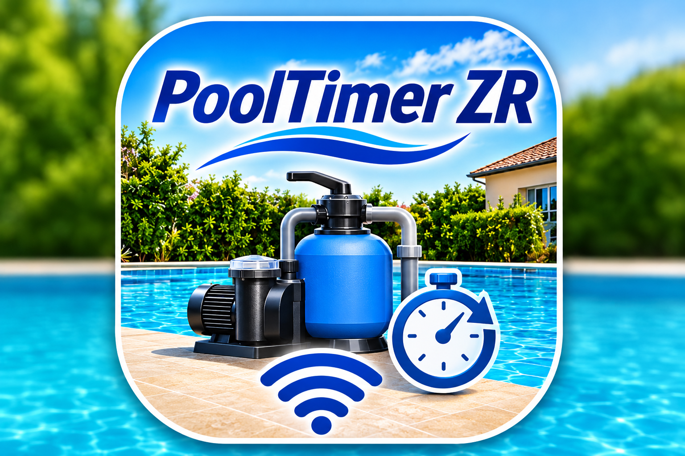
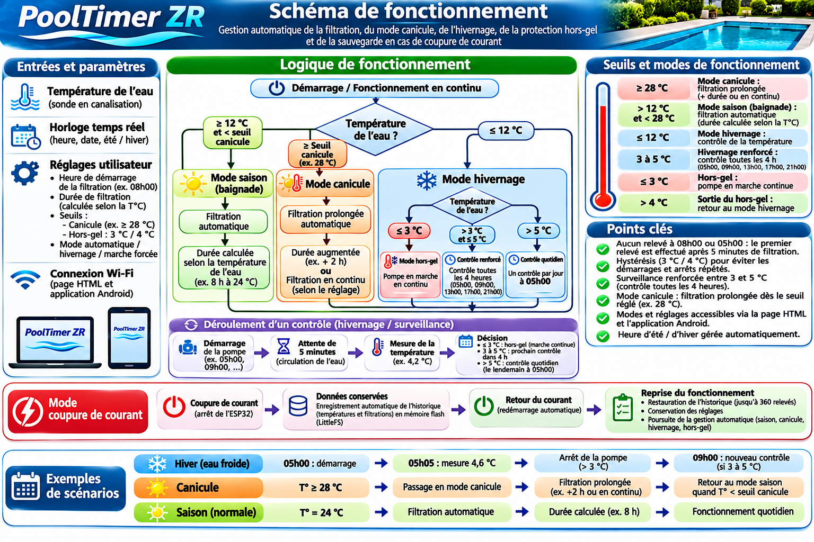
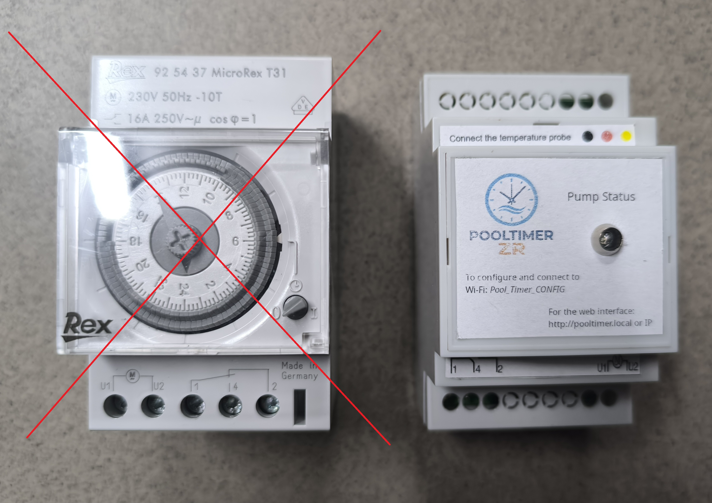
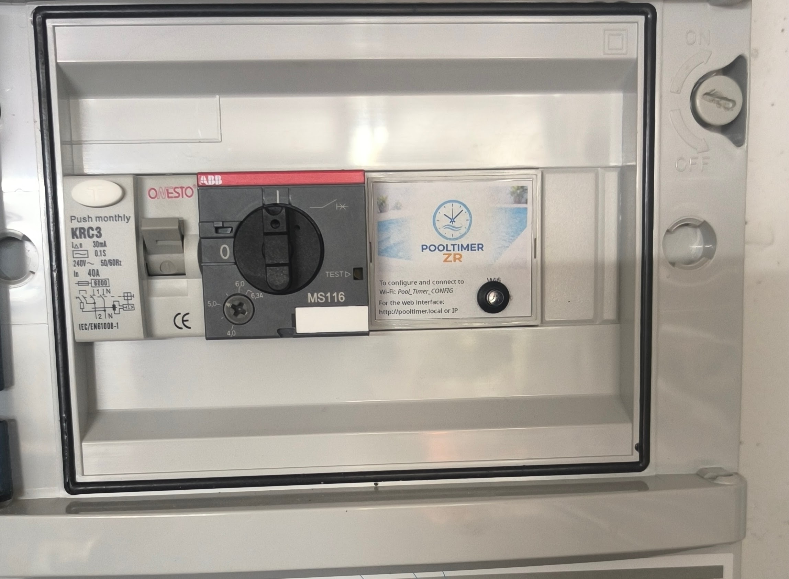
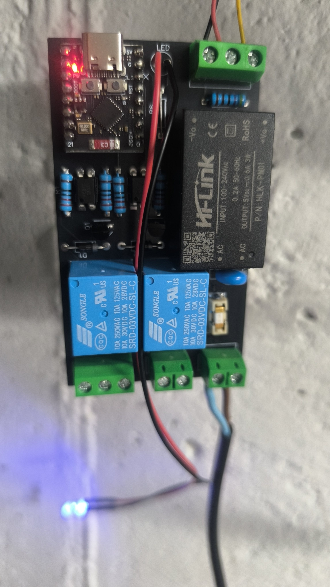
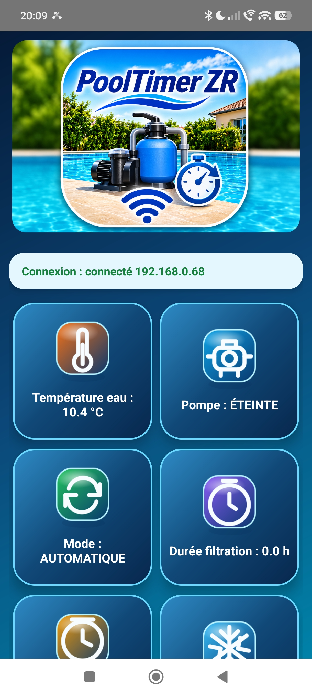

🏊‍♂️ PoolTimer ZR – La gestion intelligente de la filtration de piscine ! 💧

🔧 Un projet 100 % DIY (Do It Yourself), conçu et développé autour d'un ESP32 pour automatiser et optimiser la filtration de ma piscine en fonction de la température de l'eau.

🌡️ Filtration automatique adaptée à la température de l'eau.

☀️ Mode canicule pour renforcer la filtration lorsqu'il fait très chaud.

❄️ Mode hivernage intelligent avec surveillance de la température et protection antigel.

📱 Application Android dédiée pour surveiller et piloter la piscine depuis son smartphone.

🌐 Interface Web Wi-Fi accessible depuis un navigateur.

📊 Graphiques et historiques des températures et des cycles de filtration, conservés même après une coupure de courant.

⚙️ Pilotage manuel ou automatique selon les besoins.

🎯 L'objectif : rendre ma piscine plus autonome, optimiser les cycles de filtration et mieux maîtriser la consommation électrique.

💡 Un projet DIY mêlant électronique, programmation, domotique et développement Android, qui continue d'évoluer au fil des idées et des améliorations !

Montage : 

Le PoolTimer se monte en remplacement de la minuterie mécanique d'origine.

⚠️ Un relais de type MS116 est obligatoire pour l'alimentation de la pompe.

Le circuit imprimé doit être fabriqué chez JLCPCB :
https://jlcpcb.com/

La résistance R6 doit être remplacée par un strap si vous utilisez une LED 5 V.

Le code source de l'ESP32 ainsi que l'application Android sont fournis.

Des autocollants sont disponibles dans le dossier images (Autocollants.png). 

Une liste des pièces est fournie.

Mise en service : 

Lorsque la LED est allumée en permanence, connectez-vous au réseau Wi-Fi Pool_Timer_CONFIG afin de configurer votre réseau Wi-Fi domestique.
Une fois la configuration terminée, la LED doit se mettre à clignoter. ⚠️ Il est alors impératif d'effectuer un redémarrage (reset) du PoolTimer.

Pour accéder à l'interface de supervision, ouvrez un navigateur sur PC, smartphone ou Mac et saisissez :
- pooltimer.local
- ou l'adresse IP du PoolTimer

Vous pouvez également utiliser l'application Android fournie :
https://github.com/sergeskynet-byte/PoolTimer/blob/main/PoolTimer_V27.apk

Bon montage !
N'hésitez pas à partager vos retours et vos améliorations afin de faire évoluer le projet.
serge.skynet@gmail.com

